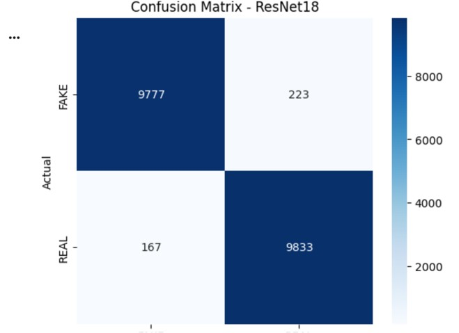
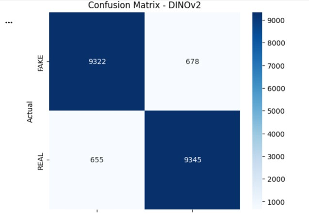

**Real and AI-Generated Image Detection**

**Project Overview**

This project focuses on classifying images as either real images or AI-generated synthetic images using deep learning models.

The project uses the CIFAKE dataset and compares two pretrained models: ResNet18 and DINOv2.

**Objectives**

\- Identify whether an image is real or AI-generated.

\- Apply deep learning techniques for image classification.

\- Compare the performance of ResNet18 and DINOv2.

\- Develop a simple web interface for image prediction.

**Dataset**

CIFAKE – Real and AI-Generated Synthetic Images

Dataset source: \[Kaggle CIFAKE Dataset](https://www.kaggle.com/datasets/birdy654/cifake-real-and-ai-generated-synthetic-images)

**Models**

\- ResNet18

\- DINOv2

**Technologies Used**

\- Python

\- PyTorch

\- Torchvision

\- NumPy

\- Scikit-learn

\- Matplotlib

\- Seaborn

\- Gradio

**Results**

|Model|Accuracy|F1-Score|
|-|-|-|
|DINOv2|93.33|0.9333|
|ResNet-18|98.05|0.9805|

**Model Evaluation**

### ResNet18 – Confusion Matrix

### DINOv2 – Confusion Matrix

**User Interface**

A Gradio interface was developed to allow users to upload an image and receive a classification prediction.

**Project Structure**

Real-and-AI-generated-image-detection/
│
├── README.md
├── requirements.txt
├── final_code.ipynb
├── DINOv2_confusion_matrix.jpg
└── resnet18_confusion_matrix.jpg

**How to Run**

1\. Clone this repository.

2\. Install the required libraries:

pip install -r requirements.txt

3\. Open the notebook in Jupyter Notebook or Google Colab.

4\. Run the notebook cells to execute the project.

**Author**

Dhanvanthiha S

